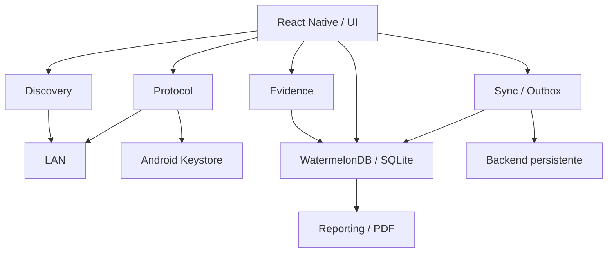

# Documento técnico

## 1. Arquitectura y decisiones

La aplicación separa las seis responsabilidades de la consigna. El destino nativo implementado es Android 7/API 24 o superior, con build de prueba para arm64. Se usa Expo como herramienta de compilación de React Native con código nativo propio; **no Expo Go**. No se implementó un bridge iOS de sockets/SSH.

| Capa         | Implementación                                                                      |
| ------------ | ----------------------------------------------------------------------------------- |
| Presentación | `src/App.tsx`, componentes en `src/ui/`                                             |
| Discovery    | `src/services/network.ts`, módulo Kotlin `FieldNetwork`                             |
| Protocol     | `src/protocol/snmp.ts`, `commands.ts`, transporte UDP/TCP y SSH nativo              |
| Evidence     | `expo-camera` con lector ML Kit, `expo-location`, `expo-file-system`                |
| Local Store  | WatermelonDB 0.28 con SQLite nativo, observación reactiva y escritores serializados |
| Sync         | `src/sync/engine.ts`, adaptador API, NetInfo y outbox persistente                   |
| Reporting    | HTML propio escapado, `expo-print`, archivos privados y `expo-sharing`              |

Las bibliotecas de la consigna son un stack sugerido. Se conservó WatermelonDB y NetInfo y se eligieron equivalentes para cámara, geolocalización, PDF y almacenamiento seguro. El bridge Kotlin reemplaza las dependencias de zeroconf/UDP/TCP/SSH y evita depender de bridges abandonados: usa `NsdManager`, `Socket`, `DatagramSocket` y JSch mantenido por mwiede. El protocolo SNMP se implementa manualmente en TypeScript. Ningún descubrimiento o diagnóstico SNMP/SSH pasa por HTTP; HTTP/HTTPS se usa para catálogo y sincronización.



## 2. Descubrimiento LAN

La UI propone el IPv4 y prefijo de una interfaz local; se limita a /22 como máximo para evitar barridos descontrolados. Acepta /22 a /32, excluye dirección de red y broadcast salvo /31 y /32.

El bridge explora servicios `_ssh._tcp`, `_http._tcp`, `_https._tcp`, `_workstation._tcp` y `_snmp._udp` mediante mDNS/Bonjour. Mantiene un multicast lock durante la ventana y libera listeners y ejecutores en `finally`. Luego sondea TCP 22/80/443 con 24 trabajadores y timeout de 350 ms por intento. Una conexión aceptada o un rechazo explícito de conexión prueba actividad; un timeout o “unreachable” no prueba que un host esté activo. Si no se obtiene evidencia TCP, se prueba una consulta SNMP UDP al puerto configurado para detectar equipos que solo responden por ese protocolo. Una respuesta o rechazo ICMP de puerto del destino prueba actividad; la consulta SNMP inicial posterior valida el contenido. La UI muestra progreso y ofrece cancelar.

Se intenta leer la caché ARP del sistema para obtener MAC. Android 10+ suele impedir leer `/proc/net/arp`; en ese caso se conserva `null` y se muestra “No disponible”. No se fabrican MAC. El hostname proviene del anuncio mDNS cuando existe. El sondeo no emite tramas Ethernet ARP crudas: Android sin root restringe ese acceso. Equipos que no anuncian mDNS y descartan todos los puertos sondeados pueden no aparecer. La entrada manual permite consultar SNMP en una IP conocida. Wi-Fi con aislamiento de clientes puede impedir el descubrimiento.

Los resultados se unen por IP; al persistir se reutiliza un equipo local con la misma IP o MAC conocida. Cada equipo observado recibe una consulta inicial a sysName, sysUpTime y sysDescr. Las respuestas y los errores se guardan como diagnósticos. La lista local representa equipos **vistos anteriormente**, no promete que sigan online; por eso muestra “Visto” y fecha.

## 3. Subconjunto SNMP

### Transporte y correlación

El encoder produce bytes BER/ASN.1 y el bridge envía un `DatagramPacket` a UDP/161 por defecto, con puerto configurable. El socket UDP se conecta al destino para filtrar respuestas de otros pares y se cierra con `use`. El timeout es configurable entre 100 y 15000 ms. Se permite un reintento de transporte ante timeout; se conserva el request-id.

Se aceptan versiones wire 0 (SNMPv1) y 1 (SNMPv2c), con community de 1–255 bytes. La respuesta debe ser GetResponse y coincidir en request-id, versión y community. GET exige misma cantidad y OIDs solicitados. Los errores del agente `error-status/error-index` se informan y registran. No se confunde una respuesta de otro request con una medición válida.

### Tipos y PDUs

| Elemento                                                                  | Soporte                                             |
| ------------------------------------------------------------------------- | --------------------------------------------------- |
| SEQUENCE, INTEGER, OCTET STRING, NULL, OBJECT IDENTIFIER                  | Encoder y parser                                    |
| PDU GetRequest `0xA0`, GetNextRequest `0xA1`, GetResponse `0xA2`          | Implementados                                       |
| IpAddress, Counter32, Gauge32, TimeTicks                                  | Parser                                              |
| Counter64                                                                 | Parser como string decimal para conservar precisión |
| noSuchObject, noSuchInstance, endOfMibView                                | Se representan con valor null                       |
| Longitud BER corta/larga definida                                         | Validada contra tamaño del datagrama                |
| Longitud indefinida, tipos PDU no soportados, datos truncados/adicionales | Rechazados                                          |

Los arcos OID usan base-128, incluyendo la primera pareja de arcos combinada, y se validan contra el rango de subidentificadores. Se limita el datagrama a 65507 bytes y la respuesta a 128 varbinds para acotar procesamiento de entrada inválida.

### MIB-II consultada

| Dato        | OID                  |
| ----------- | -------------------- |
| sysDescr.0  | 1.3.6.1.2.1.1.1.0    |
| sysUpTime.0 | 1.3.6.1.2.1.1.3.0    |
| sysName.0   | 1.3.6.1.2.1.1.5.0    |
| ifIndex     | 1.3.6.1.2.1.2.2.1.1  |
| ifDescr     | 1.3.6.1.2.1.2.2.1.2  |
| ifInOctets  | 1.3.6.1.2.1.2.2.1.10 |
| ifOutOctets | 1.3.6.1.2.1.2.2.1.16 |

Se recorre ifIndex mediante GETNEXT y se consultan las columnas por el índice devuelto: no se supone que los índices sean consecutivos. El recorrido se detiene al salir del prefijo, al recibir una excepción de fin, o a las 64 interfaces; un OID que no avanza es un error. Se muestra la limitación si la tabla se trunca. sysUpTime representa centésimas de segundo desde la inicialización de la parte de gestión del equipo.

Los contadores de 32 bits son acumulados; pueden desbordar o reiniciarse. La UI presenta bytes de entrada/salida y no los etiqueta como velocidad instantánea. No se implementan SET, traps, GetBulk, polling continuo, MIBs vendor-specific ni SNMPv3. Las communities de v1/v2c viajan sin cifrado ni integridad criptográfica; el subset está orientado a una LAN administrada. Para un producto de producción que cruce redes no confiables se requiere SNMPv3 y una política de acceso por equipo.

## 4. SSH y credenciales

JSch realiza el handshake SSH sobre TCP, negocia algoritmos y ejecuta un canal `exec`. La app tiene un catálogo cerrado para Linux/OpenWrt, MikroTik y Cisco IOS. La lista se valida tanto en TypeScript como en Kotlin; no se concatena entrada del usuario para construir comandos. Todos los comandos son de consulta. Algunos equipos pueden requerir privilegios o una sesión PTY que esta implementación no ofrece.

Primero se obtiene la huella pública SHA-256 del servidor sin autenticar con la contraseña del técnico. La pantalla permite aceptarla después de compararla por un canal confiable. Al ejecutar un comando, `StrictHostKeyChecking=yes` y el repositorio de claves solo devuelve OK cuando coincide la huella fijada. Una clave diferente detiene la conexión. Aceptar una huella sin verificarla externamente no demuestra la identidad del primer servidor (riesgo inicial de TOFU).

Usuario, contraseña y puerto solo se almacenan si el técnico activa “Recordar en Keystore”. `expo-secure-store` usa el Android Keystore para proteger el material cifrado. Las huellas, la community y el token también se conservan en SecureStore. Los secretos no se escriben en WatermelonDB, la cola, PDF ni el backend. El setting de community persistido en SQLite es siempre el valor público predeterminado; el valor elegido se carga del almacén seguro. Se deshabilita el backup Android de la app.

La contraseña permanece en memoria mientras se usa el formulario; se limpia al cerrar el equipo o después de una ejecución sin recordar. Existe una acción para olvidar credenciales y huella. Las sesiones se cierran en `finally`, con timeouts de conexión/lectura y límite temporal del comando de 20 segundos y salida de 1 MiB. La vista web conserva secretos solo en memoria y no implementa SSH.

No hay autenticación SSH por clave privada, terminal interactiva ni sincronización de credenciales. No se debilita la comprobación de host para permitir una conexión.

## 5. Evidencia y reportes

`expo-camera` captura fotos y usa ML Kit para QR, EAN-8/13, Code128, Code39, PDF417 y DataMatrix. Se solicitan permisos al usar la función, sin pedir micrófono. Los códigos se interpretan como identificadores, nunca como instrucciones ni como destinos de navegación automática. El catálogo remoto se consulta al backend configurado y se guarda localmente para uso offline.

Para una instalación se requieren equipo, sitio, técnico, notas, al menos una fotografía y GPS. Cada foto obtiene una lectura GPS propia con timestamp y precisión. La ubicación puede funcionar sin datos móviles, aunque el primer fix puede demorar o fallar en interiores. No se inventan coordenadas ni se usa una ubicación antigua silenciosamente. Si no hay permiso o fix, se ofrece un error y se puede reintentar.

Las fotos se copian desde caché a documentos privados de la app. Un borrador persistente conserva los campos y referencias mientras se completa el formulario. Se admite hasta seis fotos, con calidad JPEG reducida para el uso de campo. Las notas se escapan antes de insertarlas en HTML para impedir que se interpreten como código.

La instalación se guarda con outbox antes de generar el PDF. Se genera un A4 con datos de visita/equipo, GPS y precisión, notas, imágenes embebidas en base64 y hasta veinte diagnósticos recientes del mismo equipo y sitio. Se mueve desde caché a un directorio persistente y se puede compartir mediante el selector nativo. Si la generación falla, se conserva el registro y el worker la reintenta antes de enviar. Generar y leer el reporte no requiere una llamada al backend.

La aplicación no firma digitalmente el reporte ni modifica EXIF; la georreferencia pertenece a los datos asociados a cada foto y se imprime en el PDF. La información offline es privada de la app pero SQLite y fotos no están cifrados íntegramente; el cifrado adicional de evidencias puede ser necesario según las políticas del operador.

## 6. Persistencia y cola offline

WatermelonDB usa SQLite nativo con esquema versión 1. La tabla `entries` almacena un discriminante `kind`, una clave de entidad indexada, un JSON tipado de dominio, versión remota confirmada y fecha. Aloja equipos, diagnósticos, instalaciones, fichas cacheadas, preferencias y acciones outbox. No se llama a la API de sincronización genérica de WatermelonDB: se implementa un outbox explícito con control de adjuntos y conflictos. Los escritores serializados de WatermelonDB y `database.batch` hacen atómica la escritura de la entidad junto con su acción.

Cada edición produce una acción con ID único y snapshot inmutable. Una edición posterior no sobrescribe un snapshot leído por un worker. Campos de la acción:

```text
id, entityId, kind, payload, baseVersion, createdAt
attempts, nextAttemptAt, state, error
serverVersion, serverPayload, serverAssets (solo en conflicto)
```

Estados: pending → sending → confirmada/eliminada, pending con backoff, conflict o failed. Al arrancar, las acciones sending se recuperan como pending. Un único worker procesa FIFO y bloquea sucesoras de la misma entidad si una acción falla, espera o entra en conflicto. No bloquea entidades independientes.

La entrega tiene semántica **al menos una vez**. El backend recibe `actionId`, persiste un recibo junto con la entidad y devuelve la misma confirmación si esa acción se repite después de perderse la respuesta. Un recibo solo se considera válido para una solicitud recibida y validada. Tras confirmar, la app elimina la acción y actualiza las versiones base de sucesoras en una transacción.

Se reintenta con backoff exponencial de 2 segundos hasta 5 minutos, más jitter de hasta 1 segundo. Tras ocho fallos se marca failed y se conserva todo para revisión/reintento manual. 401/403/413 y otros errores permanentes 4xx se presentan para revisión. 408/429/5xx y errores de transporte son transitorios. Un 409 pasa a conflict y permite elegir versión local o del servidor. Conservar la local reutiliza la versión remota conocida; adoptar la del servidor descarga primero sus evidencias y solo después reemplaza el registro. Antes del reemplazo se conserva un respaldo de la entidad y sus acciones en un registro local `conflict-backup-*` para recuperación técnica.

NetInfo dispara el worker al recuperar conexión de red. Se consulta el backend configurado directamente; `isInternetReachable=false` no impide sincronizar por una LAN funcional. El worker también se ejecuta al volver a primer plano, tras guardar una instalación, manualmente y cada 20 segundos en primer plano. No existe un servicio Android que siga trabajando indefinidamente con la app cerrada. Las acciones permanecen durables hasta la próxima apertura.

## 7. Contrato del backend

El stub Node utiliza HTTP y un archivo JSON con escrituras a un temporal y rename. Serializa las mutaciones para evitar actualizaciones perdidas. No necesita una base de datos externa. Las evidencias se validan por tipo, tamaño y firma básica, se guardan con nombres SHA-256 y se referencian desde la entidad. Una petición tiene un máximo de 40 MiB; cada adjunto base64 tiene un máximo de 16 MiB y se limita la cantidad. Los archivos se escriben antes de confirmar el registro; un fallo puede dejar un blob huérfano, pero no una confirmación sin archivos.

```json
{
  "actionId": "identificador-idempotente",
  "kind": "device",
  "entityId": "ip-192.168.1.1",
  "baseVersion": 0,
  "payload": { "id": "ip-192.168.1.1", "name": "Gateway" },
  "assets": []
}
```

Respuesta OK: `200 {version: 1}`; repetición: `200 {version: 1, duplicate: true}`. Un conflicto devuelve `409 {version, payload, assets}`. Se rechazan campos sensibles `password`, `community`, `privateKey` y `token` del payload. El backend no ofrece autenticación multiusuario, autorización por tenant, cifrado en reposo, auditoría completa, pull bidireccional, retención de blobs ni una garantía de fsync ante pérdida eléctrica. Es un stub persistente para validar el flujo requerido.

Se admite token Bearer mediante variable de entorno. El tráfico HTTP claro está habilitado en el manifiesto Android para el laboratorio LAN; fuera de ese escenario se debe configurar HTTPS. Las credenciales SSH nunca se incluyen en este protocolo.

## 8. Referencias primarias

- [RFC 1157 — SNMPv1](https://www.rfc-editor.org/rfc/rfc1157)
- [RFC 1905 — PDUs de SNMPv2](https://www.rfc-editor.org/rfc/rfc1905)
- [RFC 1213 — MIB-II](https://www.rfc-editor.org/rfc/rfc1213)
- [WatermelonDB — instalación](https://watermelondb.dev/docs/Installation)
- [Expo Modules API](https://docs.expo.dev/modules/module-api/)
- [JSch mantenido por mwiede](https://github.com/mwiede/jsch)
- [Android — descubrimiento de servicios](https://developer.android.com/develop/connectivity/wifi/use-nsd)
- [Expo SecureStore](https://docs.expo.dev/versions/v54.0.0/sdk/securestore/)

## 9. Reproducibilidad de la compilación en Windows

El script de build monta temporalmente una letra libre sobre la carpeta del proyecto para acortar las rutas de Ninja/NDK y la desmonta en `finally`. No cambia la ubicación de los archivos. `scripts/prepare-native.cjs` agrega de forma idempotente el enlace explícito de `c++_shared` al CMake de Expo Modules en Windows: el alias 8.3 de clang++ puede perder los signos ++ y omitir el runtime C++ implícito. La modificación se aplica sobre dependencias instaladas y queda reproducida en el script versionado. Se compila con un worker y heap de 2 GiB para evitar picos de memoria.
