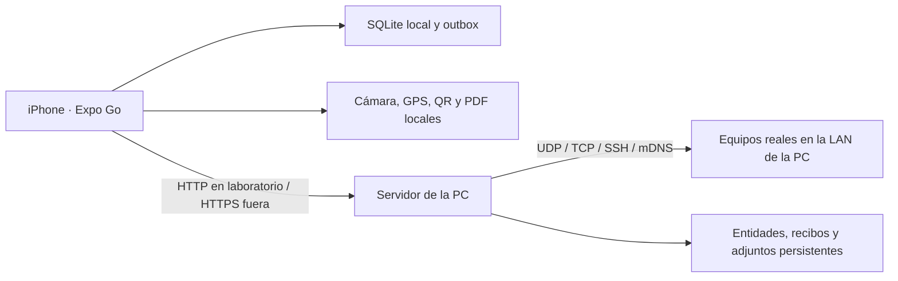

# Documento técnico · Expo Go

Adaptación del 27 de octubre de 2026 para iPhone con Expo Go. La implementación Android anterior permanece en Git; el flujo principal actual es `npm start` y escanear el QR.

## Arquitectura

| Capa           | Implementación actual                                                  |
| -------------- | ---------------------------------------------------------------------- |
| Interfaz       | React Native 0.81.5 / React 19 / TypeScript, Expo SDK 54               |
| Descubrimiento | Cliente HTTP de la app; mDNS Bonjour y sockets TCP/UDP en Node         |
| Protocolo      | BER/ASN.1 SNMP propio en la app; transporte de bytes mediante la PC    |
| SSH            | `ssh2` en la PC, comandos cerrados y huella SHA-256 aceptada en la app |
| Evidencia      | expo-camera, expo-location y expo-file-system en el iPhone             |
| Persistencia   | expo-sqlite en Expo Go; IndexedDB en preview web                       |
| Cola           | Repositorio atómico, SyncEngine propio, NetInfo y adjuntos             |
| Reportes       | HTML escapado con imágenes base64, expo-print y expo-sharing           |

El teléfono no abre sockets UDP/TCP arbitrarios en Expo Go. Los diagnósticos corresponden a la conectividad de la **computadora**, que debe alcanzar los equipos. Este cambio se identifica en la UI y en la matriz de requisitos. El módulo Kotlin anterior se usa solo si una compilación Android lo incluye; Expo Go utiliza el puente.

## Inicio y emparejamiento

`scripts/start-expo.mjs` inicia el backend y Expo CLI. Genera una clave aleatoria de laboratorio en `.cache/companion-token`, la reutiliza y pasa URL/token a Metro como variables `EXPO_PUBLIC_FIELDKIT_*`. La app inicializa la URL predeterminada y guarda el token en SecureStore. Las preferencias editadas por el usuario se conservan. El token es público dentro del bundle de desarrollo: no reemplaza autenticación de producción ni debe reutilizarse como una credencial externa.

El servidor escucha en todas las interfaces para permitir la conexión del teléfono. El puente solo se habilita con token; fuera del launcher se requiere `NETWORK_GATEWAY=1` y `SYNC_TOKEN`. El backend de evidencia puede iniciarse solo con `npm run backend`, sin habilitar diagnósticos. Los endpoints `/v1/network/*` comparten la autenticación, pero no persisten cuerpos, contraseñas ni datagramas.

## Descubrimiento e identidad

Se aceptan CIDR /22 a /32. La app divide el escaneo en lotes de 24 hosts para informar progreso y permitir cancelación. La PC usa hasta doce trabajadores por lote, con TCP 22/80/443/8291 y un sondeo SNMP al puerto UDP configurado. Solo una conexión TCP aceptada o una respuesta UDP producen un host encontrado; puertos filtrados pueden impedir la detección. La entrada manual sigue disponible.

mDNS/Bonjour proporciona hostname y nombre de servicio como campos separados cuando están disponibles. La versión puente no obtiene MAC por ARP: se muestra No disponible. No se inventan valores. Cancelar aborta el pedido del teléfono y evita lotes nuevos; el lote que ya recibió la PC finaliza dentro de su timeout.

El ID persistente es independiente de la IP. La coincidencia exige el mismo sitio; si ambos registros tienen MAC, se compara esa MAC, y en otro caso se compara la IP dentro del sitio. Se exige indicar sitio antes de agregar/escanear. Una IP repetida en otro sitio produce otra entidad y otro historial.

El puente limita los destinos a IPv4 privadas, link-local y loopback, admite como máximo 1024 hosts por solicitud, 128 KiB por cuerpo y 32 operaciones concurrentes; no permite URLs ni nombres arbitrarios como destinos. La detección no depende de Internet.

## SNMP implementado manualmente

`src/protocol/snmp.ts` genera GetRequest y GetNextRequest y parsea GetResponse. Versiones wire 0/1: SNMPv1/v2c con community. UDP/161 por defecto, puerto configurable, timeout 100–15000 ms y un reintento de transporte. Los bytes se envían en base64 al puente; Node crea un socket UDP conectado al destino, recibe del mismo par y lo cierra tras respuesta/error/timeout. El parser y la correlación permanecen en la app.

Soporta SEQUENCE, INTEGER con signo, OCTET STRING, NULL, OID base-128, IpAddress, Counter32, Gauge32, TimeTicks y Counter64 como cadena decimal. Acepta longitud definida corta/larga y rechaza truncamientos, longitudes indefinidas, tipos no soportados y bytes adicionales. Correlaciona request-id, community, versión, PDU y OIDs. Trata excepciones de fin de MIB y noSuchName de v1 en GETNEXT.

| Dato        | OID                  |
| ----------- | -------------------- |
| sysDescr.0  | 1.3.6.1.2.1.1.1.0    |
| sysUpTime.0 | 1.3.6.1.2.1.1.3.0    |
| sysName.0   | 1.3.6.1.2.1.1.5.0    |
| ifIndex     | 1.3.6.1.2.1.2.2.1.1  |
| ifDescr     | 1.3.6.1.2.1.2.2.1.2  |
| ifInOctets  | 1.3.6.1.2.1.2.2.1.10 |
| ifOutOctets | 1.3.6.1.2.1.2.2.1.16 |

Se camina ifIndex y se leen índices reales, hasta 64 interfaces; no se presuponen consecutivos. Los contadores se presentan como bytes acumulados, sin prometer velocidad instantánea. No hay SET, traps, GetBulk, SNMPv3 ni MIBs específicas de fabricantes. SNMPv1/v2c transmite la community sin cifrar; el tramo HTTP de laboratorio también transporta el datagrama. Fuera del laboratorio se requiere HTTPS, y SNMPv3 para proteger el tramo hacia el equipo.

## SSH y credenciales

La PC establece SSH con `ssh2`; la app solicita la huella SHA-256 antes de enviar credenciales SSH. El usuario debe contrastarla por otro canal y aceptarla. El servidor comprueba esa misma clave durante el siguiente handshake, antes de autenticar, y rechaza cualquier cambio.

Catálogo de consulta cerrado, validado en app y backend: Linux/OpenWrt (`uptime`, `ip -s address show`, `ip route show`), MikroTik (`/system resource print`, `/interface print stats`, `/ip route print`) y Cisco (`show version`, `show interfaces`, `show ip route`). No se concatena entrada del usuario en comandos. Tiempo máximo de veinte segundos y salida máxima de 1 MiB. No hay shell interactiva, PTY ni autenticación por clave privada.

Las credenciales se guardan solo con Recordar de forma segura. SecureStore utiliza Keychain en iOS y almacenamiento protegido en Android. Community, token y huellas también se guardan allí; SQLite solo guarda el valor público predeterminado de community. Se ofrece olvidar credenciales/huella. La PC recibe temporalmente usuario y contraseña para establecer SSH, sin guardarlos en entidades, archivos o logs. HTTPS protege ese tramo cuando no se usa la red de laboratorio. En la vista web los secretos solo están en memoria.

## Evidencia y PDF en Expo Go

La cámara permite QR, EAN-8/13, Code128/39, PDF417 y DataMatrix. Los códigos se interpretan como identificadores, sin navegar a URLs recibidas. Las fichas remotas se cachean; el catálogo del backend incluye HG8245H, RB750GR3 y LAB-001 como ejemplos.

Una instalación requiere equipo, sitio, técnico, notas, GPS y al menos una foto, hasta seis. Cada foto guarda fecha, coordenadas y precisión obtenidas en ese momento. Se solicitan permisos de cámara y ubicación en primer plano; no se usa micrófono ni geolocalización de fondo. Timeout GPS de veinticinco segundos, sin inventar coordenadas. La copia de fotos se conserva en documentos privados de Expo Go, dentro del espacio del proyecto. No desinstalar Expo Go ni borrar sus datos con evidencia pendiente.

El formulario guarda un borrador. Se persiste la instalación antes de generar el PDF. expo-print crea A4 con notas escapadas, ubicación, imágenes base64 y hasta veinte diagnósticos coincidentes. Se mueve a documentos privados y se comparte con expo-sharing. No necesita servidor ni Internet para generar. Si falla, se conserva el registro y se reintenta al sincronizar. El PDF no tiene firma digital y SQLite/evidencia no tienen cifrado integral.

## Persistencia y outbox

`LocalStore` es independiente de React Native y se prueba con un adaptador inyectado. En iOS/Android usa `expo-sqlite`, incluido en Expo Go. La tabla `local_entries` contiene clave compuesta serializada y JSON de cada fila: kind, key, data, version y updatedAt. Cada cambio confirma una transacción exclusiva que reemplaza el conjunto de filas. La estrategia es sencilla y adecuada al volumen de este TP; para grandes historiales conviene actualizar solo filas modificadas. La vista web usa una transacción IndexedDB equivalente. La base tiene otro nombre y no migra los datos de la versión WatermelonDB anterior.

Los escritores se serializan. Entidad y acción outbox se confirman juntas antes de notificar la UI. Un error de disco no publica cambios en memoria. Cada edición conserva un snapshot inmutable con ID propio y createdAt estrictamente creciente. La confirmación elimina su acción y propaga la versión remota a las sucesoras sin sobrescribir ediciones locales posteriores.

Estados: pending → sending → confirmada/eliminada, pending con backoff, conflict o failed. Un único worker aplica FIFO y bloquea sucesoras de la entidad en espera/conflicto/error. Al iniciar recupera sending. Los errores transitorios permanecen pending **sin límite de intentos**, con backoff de 2 segundos a 5 minutos más jitter. Los 4xx permanentes, salvo 408/429, requieren corregir y reintentar. NetInfo al reconectar fuerza el intento inmediato de pendientes; el temporizador no envía si no hay conectividad. También se intenta cada veinte segundos con la app activa y al volver al primer plano. No se promete ejecución con Expo Go cerrado.

El backend persiste recibos actionId y versiones: reenvíos confirmados son idempotentes. HTTP 409 conserva versión, datos y adjuntos remotos. Elegir local reencola contra la versión del servidor; elegir servidor descarga los adjuntos y conserva un respaldo local antes de reemplazar entidad/acciones relacionadas.

La sincronización incluye fotos JPEG y PDF reales en base64. Backend limita 40 MiB por petición, diez adjuntos y tamaño individual, valida firma básica, almacena archivos por SHA-256 y confirma el estado mediante archivo temporal y rename. Es un backend mínimo de laboratorio, sin administración multiusuario ni garantías de producción.
